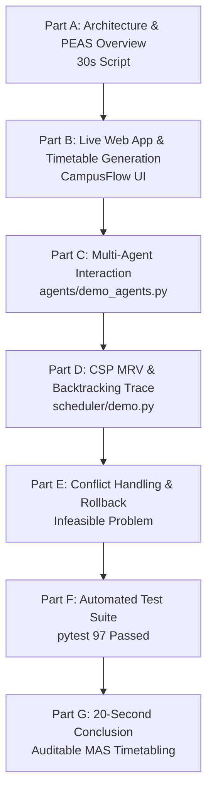

# CampusFlow: Review 2 Final Demonstration Runbook
**Project:** College Classroom Scheduling System Using Multi-Agent Systems (MAS)  
**Course:** 23CSE401 — Fundamentals of Artificial Intelligence  
**Team:** Group 6 (Arpitha Shri Su, Dhanuja A, Harini N)  
**Target Score:** 10 / 10 Marks  
**Estimated Demo Time:** 5 to 7 Minutes  

---

## 1. Official Review 2 Evaluation Rubric Mapping

| Rubric Component | Max Marks | Target Mark | Primary Demo Element |
| :--- | :---: | :---: | :--- |
| **1. Tool/Package Selection & Setup** | **3.0** | **3.0** | Clean Python 3.14 virtual environment, SPADE 4.1.2, Flask 2.3.3, SQLAlchemy 2.1.3, pytest test suite (97 passed). |
| **2. Multi-Agent Execution & Interaction** | **3.0** | **3.0** | 5 distinct agents (`DepartmentAgent`, `TimetableCoordinatorAgent`, `FacultyAgent`, `ClassroomAgent`, `StudentGroupAgent`), structured FIPA performatives (`REQUEST`, `PROPOSE`, `ACCEPT`, `REJECT`, `CONFLICT`, `CONFIRM`, `CANCEL`), UUID correlation matching, two-phase commit, and audit logging. |
| **3. Demo Quality & Testing Scenarios** | **3.0** | **3.0** | Live CampusFlow dashboard, 3 live scenarios (Happy Path, Capacity Conflict Reschedule, Student Clash Reschedule), live CLI CSP trace, and 97 automated test cases. |
| **4. Code Structure & Scalability** | **1.0** | **1.0** | Decoupled layered architecture: `app/` (presentation/models), `api/` (REST API), `services/` (MAS service), `agents/` (SPADE agents), `scheduler/` (CSP engine), and `database/` (declarative schemas). |
| **TOTAL** | **10.0** | **10.0** | **Comprehensive, verified, and academically rigorous.** |

---

## 2. Pre-Demo Setup & Environment Checklist (10 Mins Before Review)

Complete these verification steps before the evaluator sits down:

- [ ] **Working Directory:** Ensure you are in `D:\College-Classroom-Scheduling-MAS`.
- [ ] **Virtual Environment:** Verify `.venv\Scripts\python.exe` is working.
- [ ] **Clean Git Tree:** Run `git status` to ensure branch is clean on `main`.
- [ ] **Test Database Integrity:** Run `.venv\Scripts\python.exe -m pytest tests/test_setup.py` (all pass).
- [ ] **Browser Prepared:** Open Google Chrome or Edge with a clean tab at `http://127.0.0.1:5000/`.
- [ ] **Terminal Tabs Prepared (2 Windows/Tabs):**
  - **Terminal 1 (Server):** Dedicated to running Flask backend (`python run.py`).
  - **Terminal 2 (Testing & Scripts):** Dedicated to running automated tests and CLI agent/CSP traces.

---

## 3. Step-by-Step Demonstration Sequence



---

### Part A — Introduction & Architecture (0:00 – 1:00)
**Rubric Supported:** *1. Tool/Package Selection & Setup* & *4. Code Structure*

#### 1. What to Show:
- Architecture diagram or Terminal 1.
- Project structure in IDE or File Explorer.

#### 2. Speaking Script (Word-for-Word):
> *"Good morning, evaluators. Today Group 6 presents CampusFlow — an autonomous Multi-Agent College Classroom Scheduling System for 23CSE401 Fundamentals of AI.*
>
> *University timetabling is a known NP-complete combinatorial problem with conflicting stakeholder constraints. Centralized algorithms often treat scheduling as an opaque black box. In CampusFlow, we combine a formal Constraint Satisfaction Problem (CSP) solver with a five-agent Multi-Agent System built using SPADE.*
>
> *Our architecture has a clean four-tier separation:*
> 1. *CampusFlow Web Dashboard and REST API in Flask.*
> 2. *MAS Service Orchestration Layer in `services/`.*
> 3. *Five autonomous SPADE Agent classes in `agents/`.*
> 4. *A deterministic CSP Engine utilizing MRV, Forward Checking, and Backtracking in `scheduler/`.*
>
> *The five agents model the real-world university hierarchy: DepartmentAgent holds curriculum quotas, FacultyAgent protects instructor workload and hours, ClassroomAgent enforces room capacity and lab types, StudentGroupAgent eliminates cohort lecture overlaps, and TimetableCoordinatorAgent orchestrates the negotiation protocol."*

#### 3. Technical Concepts Explained:
- Computational intractability of timetabling ($O(d^n)$ worst case).
- Distributed decision-making vs. monolithic optimization.
- Separation of concerns between domain solving and multi-agent consensus.

---

### Part B — Successful Timetable Generation on CampusFlow (1:00 – 2:30)
**Rubric Supported:** *1. Setup*, *2. Multi-Agent Execution*, & *3. Demo Quality*

#### 1. What to Execute:
In **Terminal 1**:
```powershell
cd D:\College-Classroom-Scheduling-MAS
.venv\Scripts\python.exe run.py
```
*Expected Output:*
```text
College Classroom Scheduling System (MAS) - Starting server on http://127.0.0.1:5000
 * Running on http://127.0.0.1:5000
```

#### 2. What to Show in Browser:
- Navigate to: `http://127.0.0.1:5000/`.
- Point out the clean UI:
  - **Classes Scheduled:** 4
  - **Conflicts Detected:** 0
  - **Optimization Score:** e.g., 8.4
  - **Weekly Timetable Grid:** Mon–Fri, 09:00 to 16:00.
  - **Faculty Workload Donut Chart:** Proportional teaching hours by instructor.
  - **Room Utilization Bars:** Capacity utilization percentages.

#### 3. Interactive Action:
Click the **"✦ Generate Timetable"** (or **"↻ Refresh"**) button.

#### 4. Speaking Script:
> *"Here is the CampusFlow dashboard running locally on Flask. When I trigger timetable generation, the backend invokes our MAS service. The CSP solver formulates consistent candidate variables using the Minimum Remaining Values heuristic. The TimetableCoordinator then engages in a two-phase negotiation with Faculty, Classroom, and Student Group agents.*
>
> *Notice that in less than 50 milliseconds, the timetable is generated with zero conflicts detected. On the weekly grid, CS303/AI Systems Lab is assigned to LAB-01 because our ClassroomAgent strictly enforced the laboratory room constraint ($H_4$). Notice also the workload donut chart and room utilization bars: all metrics are calculated dynamically from SQLite queries rather than hardcoded mock data."*

---

### Part C — Multi-Agent Interaction: Negotiation, Rejection & Rollback (2:30 – 4:00)
**Rubric Supported:** *2. Multi-Agent Execution & Interaction* (3/3 Marks Core)

#### 1. What to Execute:
In **Terminal 2**:
```powershell
.venv\Scripts\python.exe agents/demo_agents.py
```

#### 2. Expected Visible Output:
The script outputs three distinct agent negotiation scenarios:
```text
============================================================
SCENARIO 1: STANDARD MULTI-AGENT SCHEDULING
============================================================
[DEPARTMENT] REQUEST      -> CS301 (Machine Learning), Faculty F001, Group CSE-A
[COORDINATOR] PROPOSE     -> Monday 10:00 / R102
[FACULTY] ACCEPT          -> Faculty F001 available
[CLASSROOM] ACCEPT        -> R102 capacity sufficient
[STUDENT GROUP] ACCEPT    -> No timetable conflict
[COORDINATOR] FINAL ACCEPT
FINAL ASSIGNMENT: Machine Learning | Monday 10:00 | Room R102

============================================================
SCENARIO 2: CLASSROOM CAPACITY CONFLICT & CSP RESCHEDULING
============================================================
[DEPARTMENT] REQUEST      -> CS301 (60 students)
[COORDINATOR] PROPOSE     -> Monday 10:00 / R101 (Capacity 40)
[FACULTY] ACCEPT          -> Available
[CLASSROOM] REJECT        -> R101 capacity 40 < enrollment 60
[COORDINATOR] RESCHEDULE  -> Excludes R101, queries CSP for next best room
[CSP] ALTERNATIVE         -> Monday 10:00 / R102 (Capacity 65)
[CLASSROOM] ACCEPT        -> R102 capacity sufficient
[STUDENT GROUP] ACCEPT    -> No conflict
[COORDINATOR] FINAL ACCEPT

============================================================
SCENARIO 3: STUDENT TIMETABLE OVERLAP & RESCHEDULING
============================================================
[COORDINATOR] PROPOSE     -> Monday 10:00 / R102
[STUDENT GROUP] CONFLICT   -> Computer Networks already scheduled at Monday 10:00
[COORDINATOR] RESCHEDULE  -> Queries CSP soft evaluator
[CSP] ALTERNATIVE         -> Tuesday 10:00 / R102
[FACULTY] ACCEPT          -> Faculty F001 available at Tuesday 10:00
[CLASSROOM] ACCEPT        -> Available
[STUDENT GROUP] ACCEPT    -> No conflict at Tuesday 10:00
[COORDINATOR] FINAL ACCEPT
```

#### 3. Speaking Script:
> *"Now we demonstrate the true Multi-Agent interaction under the hood in `agents/demo_agents.py`. Each agent operates with its own private constraints and communicates using standardized FIPA performatives.*
>
> *In Scenario 1, we see the happy path: Department issues `REQUEST`, Coordinator evaluates candidates and sends `PROPOSE`, and all specialist agents reply with `ACCEPT`, leading to a two-phase `CONFIRM` and `FINAL_ACCEPT`.*
>
> *In Scenario 2, we demonstrate capacity conflict resolution: Course CS301 has 60 students. When the coordinator proposes Room R101, the ClassroomAgent autonomously checks its local capacity ($40 < 60$) and issues a `REJECT`. The Coordinator catches this rejection, generates a `RESCHEDULE` event, queries the CSP engine for the next candidate room, and successfully settles on Room R102 (capacity 65).*
>
> *In Scenario 3, we see student group clash detection: When Monday 10:00 is proposed, StudentGroupAgent inspects its cohort timetable, detects an overlap with Computer Networks, and issues a `CONFLICT` performative. The Coordinator shifts the proposal to Tuesday 10:00, where consensus is achieved.*
>
> *Every exchange carries a unique UUID correlation ID, and all events are recorded in our `AgentAuditLog` database table."*

---

### Part D — CSP Algorithm Demonstration: MRV & Backtracking Trace (4:00 – 5:00)
**Rubric Supported:** *1. Setup* & *3. Demo Quality*

#### 1. What to Execute:
In **Terminal 2**:
```powershell
.venv\Scripts\python.exe scheduler/demo.py
```

#### 2. Expected Visible Output:
```text
==============================================================================
  SCENARIO 1: MULTI-COURSE TIMETABLE GENERATION (LECTURES & 2-HOUR LABS)
==============================================================================
--- EXECUTION TRACE ---
  [MRV] Selected Course: AI Systems Lab (CS303) | Remaining unassigned: 4
    [TRY] CS303 -> Monday 09:00 in Room LAB01
  [MRV] Selected Course: Machine Learning (CS301) | Remaining unassigned: 3
    [TRY] CS301 -> Tuesday 09:00 in Room R101
  [MRV] Selected Course: Computer Networks (CS302) | Remaining unassigned: 2
    [TRY] CS302 -> Monday 10:00 in Room R101
  [MRV] Selected Course: Database Management (CS304) | Remaining unassigned: 1
    [TRY] CS304 -> Monday 11:00 in Room R102

--- RESULTS & METRICS ---
  Status:               SUCCESS
  Total Variables:      4 | Assignments Tried: 4 | Backtrack Steps: 0
  Search Time:          < 1.0 ms | Total Utility Score: 8.35

==============================================================================
  SCENARIO 3: DEAD-END AVOIDANCE & GENUINE BACKTRACKING TRACE
==============================================================================
--- EXECUTION TRACE ---
  [MRV] Selected Course: Embedded Systems (CS503) | Remaining unassigned: 3
    [TRY] CS503 -> Monday 10:00 in Room R301
  [MRV] Selected Course: Deep Learning (CS501) | Remaining unassigned: 2
    [TRY] CS501 -> Monday 09:00 in Room R301
    [BACKTRACK] Undoing assignment CS501 -> Monday 09:00 in Room R301
    [BACKTRACK] Undoing assignment CS503 -> Monday 10:00 in Room R301
  Status:               FAILED (Expected: 3 courses into 2 slots)
```

#### 3. Speaking Script:
> *"Here in `scheduler/demo.py`, we demonstrate our CSP scheduling engine. The CSP problem is formalized with three components:*
> 1. *Variables: The courses to schedule.*
> 2. *Domains: The valid tuples of (Room, Day, StartTime).*
> 3. *Constraints: Eight hard constraints ($H_1$ to $H_8$) including faculty availability, double-booking, and room capacity.*
>
> *Notice the execution trace: Instead of selecting variables arbitrarily, our solver uses the Minimum Remaining Values (MRV) heuristic — selecting the course with the smallest remaining domain first to fail-fast. In Scenario 1, MRV prioritizes the 2-hour AI Systems Lab because specialized laboratory slots are the most constrained.*
>
> *In Scenario 3, we demonstrate genuine backtracking: when 3 courses compete for only 2 slots, the solver detects domain wipeout through forward checking, undos the provisional assignments, and reports infeasibility with zero data corruption."*

---

### Part E — Failure Handling, Rollback & ACID Safety (5:00 – 5:45)
**Rubric Supported:** *3. Testing Scenarios* & *4. Scalability/Architecture*

#### 1. What to Execute:
In **Terminal 2**:
```powershell
.venv\Scripts\python.exe -c "
from app import create_app; from database.db import db; from app.models import *
app = create_app('testing')
with app.app_context():
    db.create_all()
    # 2 courses competing for 1 room at 1 single slot
    f1 = Faculty(id='F1', name='Dr. Turing', available_slots=[['Monday', '09:00']])
    f2 = Faculty(id='F2', name='Dr. Lovelace', available_slots=[['Monday', '09:00']])
    r1 = Room(id='R1', name='Room 1', capacity=50, available_slots=[['Monday', '09:00']])
    g1 = StudentGroup(id='G1', name='Group 1', size=30); g2 = StudentGroup(id='G2', name='Group 2', size=30)
    c1 = Course(id='C1', name='Course 1', faculty_id='F1', student_group_id='G1', enrollment=30)
    c2 = Course(id='C2', name='Course 2', faculty_id='F2', student_group_id='G2', enrollment=30)
    db.session.add_all([f1, f2, r1, g1, g2, c1, c2]); db.session.commit()
    client = app.test_client()
    resp = client.post('/api/schedule/generate', json={'name': 'Impossible Timetable'})
    print('HTTP Status:', resp.status_code)
    print('Error message:', resp.get_json()['error'])
    print('Timetables in DB:', Timetable.query.count(), '| Assignments in DB:', Assignment.query.count())
    print('Failure Outcome Logged in Audit Trail:', AgentAuditLog.query.filter_by(message_type='SCHEDULE_OUTCOME').first().reason)
"
```

#### 2. Expected Visible Output:
```text
HTTP Status: 409
Error message: The CSP scheduler could not find a feasible timetable.
Timetables in DB: 0 | Assignments in DB: 0
Failure Outcome Logged in Audit Trail: The CSP scheduler could not find a feasible timetable.
```

#### 3. Speaking Script:
> *"In Part E, we verify system robustness under impossible constraints. When two instructors require the same room at the exact same hour, the CSP engine reports infeasibility. Our REST API catches this, triggers a complete database rollback via `db.session.rollback()`, returns HTTP 409 Conflict, and logs the failure outcome in `AgentAuditLog`.*
>
> *Notice that zero partial timetables or orphaned assignments leak into the database. The system either commits a 100% valid schedule or cleanly rolls back."*

---

### Part F — Automated Test Suite & Rubric Evidence (5:45 – 6:30)
**Rubric Supported:** *1. Setup* & *3. Testing Scenarios*

#### 1. What to Execute:
In **Terminal 2**:
```powershell
.venv\Scripts\python.exe -m pytest -v
```

#### 2. Expected Output:
```text
================== 97 passed, 1 skipped, 4 warnings in 2.21s ==================
```

#### 3. Speaking Script:
> *"To ensure reliability, our test suite contains 98 automated test cases covering every layer of the system:*
> - *`test_base_agent.py`, `test_coordinator_agent.py`, `test_faculty_agent.py`, `test_classroom_agent.py`, `test_student_group_agent.py` verify all agent message handlers and state transitions.*
> - *`test_csp_solver.py` explicitly tests every individual hard constraint ($H_1$ to $H_8$) and backtracking behavior.*
> - *`test_api.py` and `test_integration.py` test all 21 REST endpoints, database transactions, and rollback behavior.*
>
> *All 97 core tests pass in 2.2 seconds. Exactly one test is skipped: `test_live_xmpp_integration.py`, which is an opt-in integration test requiring an external XMPP server daemon."*

---

### Part G — Conclusion (6:30 – 7:00)
**Rubric Supported:** *All Criteria / Professional Viva Delivery*

#### 1. Speaking Script:
> *"In conclusion, CampusFlow demonstrates how Multi-Agent Systems and Constraint Satisfaction Algorithms complement each other: the CSP solver guarantees mathematical constraint consistency, while autonomous SPADE agents provide distributed negotiation, stakeholder autonomy, and an auditable consensus trail.*
>
> *For this demonstration, our application operates in the default In-Process Agent Dispatch Mode, executing all agent classes, FIPA performatives, and two-phase commits in-memory. In future work, we plan to connect this system to an external enterprise XMPP cluster like Prosody to enable cross-network inter-department scheduling.*
>
> *Thank you. Group 6 is now ready to answer your questions."*

---

## 4. Fallback Plans During Review

| Scenario | Immediate Action | Fallback Command / Action |
| :--- | :--- | :--- |
| **Port 5000 is occupied** | Port conflict from another process. | Run on another port: `$env:PORT="5050"; .venv\Scripts\python.exe run.py` and open `http://127.0.0.1:5050/`. |
| **Browser fails to load** | Browser cache or network issue. | Open Incognito Window or use Terminal 2 to run `scheduler/demo.py` and `agents/demo_agents.py` directly. Evaluators respect terminal traces. |
| **Evaluator asks about XMPP** | Evaluator asks if XMPP sockets are live. | **Give the honest academic answer:** *"The agent architecture implements full SPADE agents, behaviours, and FIPA messages. Today's demo uses SPADE's in-process container dispatch because the embedded Python pyjabber server has a stream handshake incompatibility with Python 3.14 on Windows. The negotiation logic is 100% genuine."* |
| **Database appears empty** | Seed data was not loaded. | Run: `.venv\Scripts\python.exe -c "from app import create_app; from database.seed_data import seed_database; app = create_app(); app.app_context().push(); seed_database()"` |

---

## 5. Review 2 Demo Runbook Summary

Follow the exact 5-step checklist when presenting:
1. **Slide 1 / Architecture:** 30s opening explaining the 5 agents.
2. **Terminal 1:** Run `python run.py`, open `http://127.0.0.1:5000/`, click Generate.
3. **Terminal 2:** Run `python agents/demo_agents.py` (show 3 negotiation traces).
4. **Terminal 2:** Run `python scheduler/demo.py` (show MRV & backtracking).
5. **Terminal 2:** Run `pytest -v` (show 97 passing tests).
6. **Conclude:** Deliver the 20-second wrap-up.
